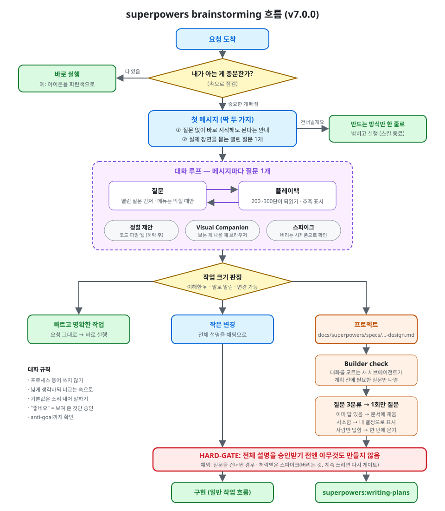
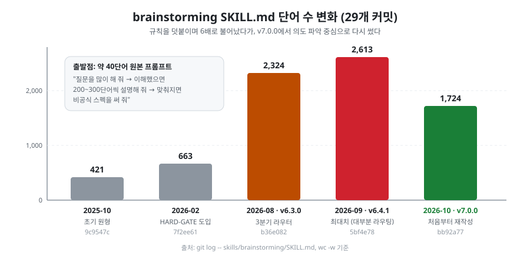
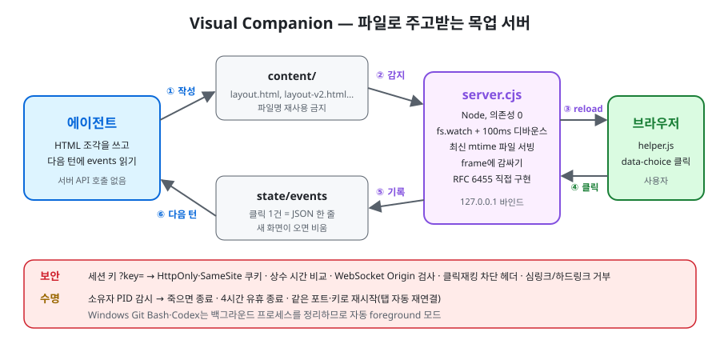
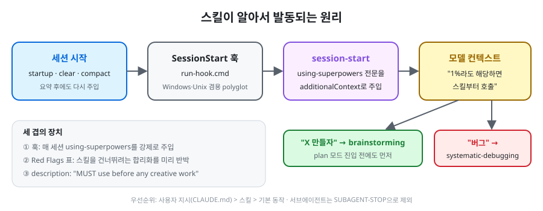
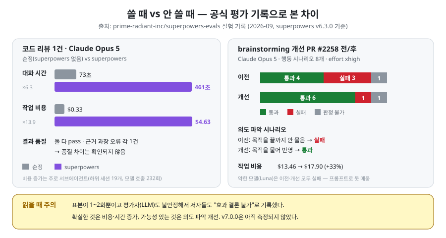
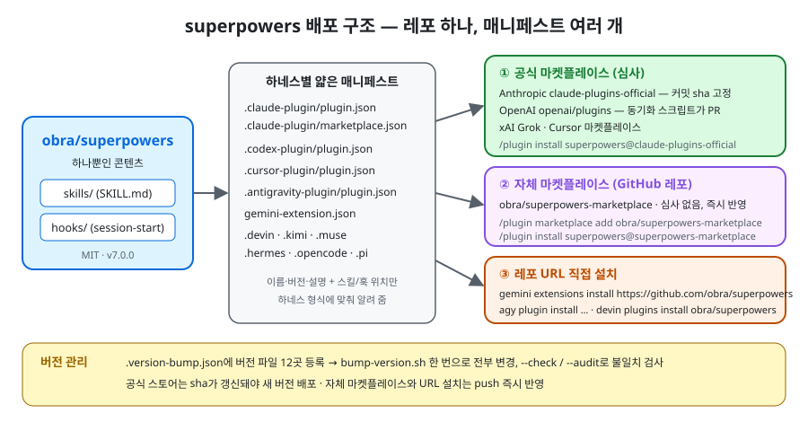

# Analysis of Superpowers

[obra/superpowers](https://github.com/obra/superpowers)(MIT, Jesse Vincent)는 Claude Code·Codex·Gemini CLI 등 코딩 에이전트에
"일하는 방식"을 스킬(SKILL.md) 묶음으로 주입하는 플러그인이다. 이 레포는 그 내부를 읽고 **왜 이렇게 설계했는지**를 정리한 분석 노트다.

- 분석 기준: `obra/superpowers` **v7.0.0** (`bb92a77`, 2026-10-09)
- 주제: **brainstorming 스킬**(v7.0.0에서 처음부터 다시 쓴 스킬), **스토어 배포 구조**

## 한눈에 보기 — brainstorming 흐름

요청이 오면 먼저 **속으로 점검**한다. 필요한 게 요청에 다 있으면 바로 하고, 빠진 게 있으면 열린 질문으로 대화를 시작한다.
질문과 플레이백(이해한 것 되읽기)을 번갈아 하다가 이해가 되면 **작업 크기**를 정한다.
프로젝트 크기면 설계 문서를 쓰고, 대화를 모르는 서브에이전트가 **Builder check**로 빈칸을 찾는다.
어떤 크기든 **HARD-GATE**(전체 설명 승인)를 통과해야 구현에 들어간다. → 자세히: [01-flow.md](brainstorming/01-flow.md)

## 설계 변천사

실패 사례마다 규칙을 덧붙이며 421단어 → 2,613단어로 불어났고, 대부분이 라우팅·승인 단계였다.
v7.0.0은 "40단어 원본 프롬프트"의 정신으로 돌아가 **의도 파악 중심**으로 처음부터 다시 썼다. → 자세히: [02-evolution.md](brainstorming/02-evolution.md)

## Visual Companion

에이전트는 HTML 파일을 쓰고, 사용자가 브라우저에서 클릭한 선택은 `state/events` 파일로 돌아온다.
서버는 의존성 없는 Node 스크립트이고, 로컬 서버지만 세션 키·Origin 검사·수명 관리를 갖췄다. → 자세히: [03-visual-companion.md](brainstorming/03-visual-companion.md)

## 스킬이 알아서 발동되는 원리

세션 시작 훅이 `using-superpowers` 스킬 전문을 매번 컨텍스트에 넣고, "1%라도 해당하면 스킬부터"라는 규칙이 brainstorming을 먼저 부른다. → 자세히: [04-bootstrap.md](brainstorming/04-bootstrap.md)

## 쓸 때 vs 안 쓸 때

공식 평가 레포(superpowers-evals)의 순정 vs superpowers 실험을 보면, **시간·비용 증가는 분명**하다(코드 리뷰 1건에서 시간 6.3배, 비용 13.9배).
**품질 향상은 아직 증명되지 않았다.** 다만 brainstorming 개선 PR에서 의도 파악이 좋아진 신호(Opus 5, 실패 → 통과)는 있다.
표본이 1~2회라 방향만 참고해야 한다. → 자세히: [06-performance.md](brainstorming/06-performance.md)

## 스토어 배포 구조

스킬과 훅은 한 벌만 두고, 하네스마다 얇은 매니페스트(`.claude-plugin/`, `.codex-plugin/`, `gemini-extension.json` 등)로 감싼다.
배포 경로는 세 가지다. **공식 마켓플레이스**(심사, 커밋 sha 고정), **자체 마켓플레이스**(GitHub 레포가 곧 스토어), **레포 URL 직접 설치**.
내 플러그인을 같은 방식으로 올리는 절차도 정리했다. → 자세히: [distribution/01-marketplace.md](distribution/01-marketplace.md)

## 목차

| # | 문서 | 내용 |
|---|------|------|
| 1 | [brainstorming/01-flow.md](brainstorming/01-flow.md) | 스킬이 대화를 어떻게 진행하는가 (첫 메시지 → 플레이백 → 크기 판정 → 설계 문서 → Builder check → Hard gate) |
| 2 | [brainstorming/02-evolution.md](brainstorming/02-evolution.md) | 421단어 → 2,613단어 → 재작성. 29번의 커밋으로 본 설계 변천사 |
| 3 | [brainstorming/03-visual-companion.md](brainstorming/03-visual-companion.md) | 브라우저 목업 서버(`server.cjs`) 구조: 의존성 0 WebSocket, 토큰 인증, 수명 관리 |
| 4 | [brainstorming/04-bootstrap.md](brainstorming/04-bootstrap.md) | 스킬이 "알아서" 발동되는 원리: SessionStart 훅 + using-superpowers |
| 5 | [brainstorming/05-takeaways.md](brainstorming/05-takeaways.md) | 배울 점과 내 프로젝트에 적용할 점 |
| 6 | [brainstorming/06-performance.md](brainstorming/06-performance.md) | 쓸 때 vs 안 쓸 때: 공식 평가 기록으로 본 시간·비용·품질 차이 |
| 배포 | [distribution/01-marketplace.md](distribution/01-marketplace.md) | 스토어(마켓플레이스)에 올리는 구조와 내 플러그인 등록 절차 |

## 한 줄 요약

> 코딩 에이전트는 만드는 건 잘하지만, **사람이 실제로 원하는 것**을 묻지 않고 짐작으로 만든다.
> brainstorming 스킬은 "만들기 전에 왜를 알아내라"를 강제하는 프롬프트이고,
> v7.0.0은 절차(라우팅·승인 단계) 중심으로 비대해진 스킬을 **의도 파악 중심**으로 되돌린 재작성이다.

## 분석 방법

1. `git clone https://github.com/obra/superpowers` 후 `skills/brainstorming/` 전체와 관련 훅·스펙 문서를 읽었다.
2. `git log -- skills/brainstorming/SKILL.md`로 2025-10 ~ 2026-10 변경 이력 29개를 따라가며 버전별 단어 수와 구조 변화를 비교했다.
3. 성능 비교는 공식 평가 레포 [prime-radiant-inc/superpowers-evals](https://github.com/prime-radiant-inc/superpowers-evals)의 `docs/experiments/` 기록을 읽어 정리했다(직접 실행한 측정이 아님).
4. 설계 의도는 레포 안의 스펙 문서 `docs/superpowers/specs/2026-10-05-brainstorming-rebuild-design.md`와 `RELEASE-NOTES.md`를 근거로 삼았다.

인용은 원문 영어를 짧게만 사용하고, 나머지는 한국어로 요약했다.
