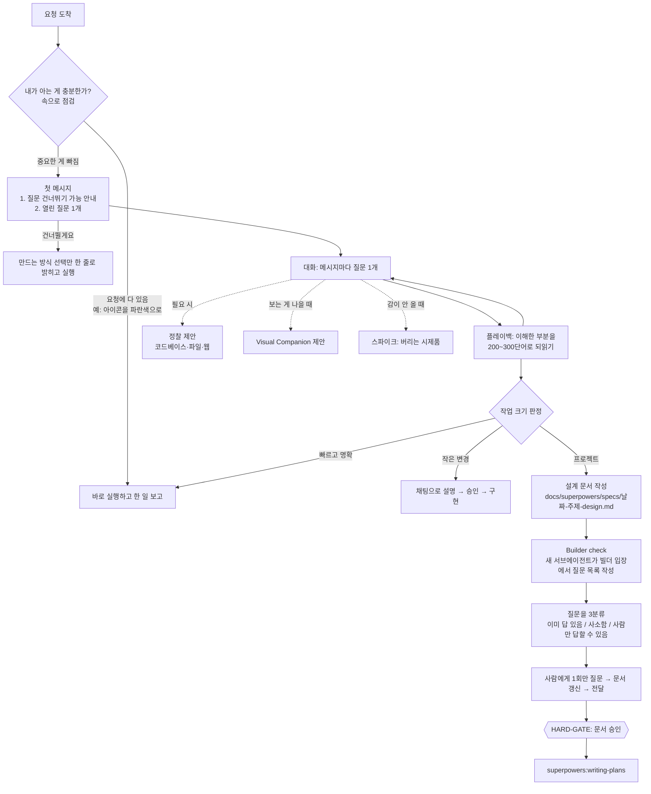

# 1. brainstorming 스킬의 대화 흐름

대상 파일: `skills/brainstorming/SKILL.md` (v7.0.0, 225줄 / 1,724단어)

## 스킬이 푸는 문제

SKILL.md 첫 문단이 문제를 정확히 짚는다. 에이전트는 "사람이 원한다고 **믿는 것**"을 만들고, 그 믿음은 느끼는 것보다 얇다.
그래서 이 스킬의 목표는 설계 문서를 만드는 게 아니라 **사람이 원하는 것과 그 이유(why)를 끌어내는 것**이다.

> 왜 "why"인가? — 요청에는 적히지 않은 결정이 수백 개 있다. 이유를 알면 에이전트가 그 결정들을 사람이 했을 법한 방식으로 내릴 수 있다.

## 전체 흐름

맨 위 이미지와 같은 내용이다. GitHub에서 노드를 텍스트로 보고 싶다면 아래 Mermaid 버전을 펼친다.

Mermaid 버전

## 단계별 분석

### 1) 시작 전 자기 점검 — "내가 실제로 아는 게 뭐지?"

요청 안에 필요한 게 다 있으면(예: "아이콘을 cornflower blue로") 질문 없이 바로 한다.
**설계 이유:** 이전 버전은 "투두 리스트 하나도 반드시 설계를 거쳐라"였다. 사소한 요청에도 절차가 붙으니 사용자가 지치고,
스펙 문서의 anti-goal인 "작은 요청이 다단계 프로젝트로 부풀기"가 실제로 일어났다. 그래서 **가볍게 끝낼 출구를 맨 앞에** 뒀다.

### 2) 첫 메시지는 딱 두 가지

1. "질문 없이 바로 시작하길 원하면 말해 달라"는 한 줄
2. 실제 장면을 떠올리게 하는 **열린 질문 하나** ("이게 있었으면 좋겠다고 느낀 순간이 언제였나요?")

**설계 이유:** 프로세스를 먼저 설명하지 않는다(Red Flags 표: "프로세스는 저절로 드러난다").
그리고 옵트아웃을 처음에 한 번만 알려서, 원하지 않는 사람을 붙잡지 않는다.

### 3) 대화 규칙

| 규칙 | 이유 |
|------|------|
| 메시지마다 질문 **1개**, 예시 답 목록 금지 | 질문 여러 개는 심문(interrogation)이 된다 |
| **열린 질문 먼저**, 메뉴(선택지)는 막혔을 때만 | 선택지는 에이전트의 가정 쪽으로 사람을 끌고 간다 (garden-pathing) |
| "그냥 정해줘" → 구체적으로 제안 | 사람에게 에이전트의 생각을 떠넘기지 않는다 |
| 사용자 어휘에 맞추고 프로세스 용어 금지 | "스펙", "바운디드" 같은 말은 사람을 대화에서 밀어낸다 |
| "다뤄야 할 영역"은 **지도이지 대본이 아님** | 체크리스트를 읽어 주면 심문이 된다 |

다뤄야 할 영역: 이게 어떤 것이고 무엇이 특별한지 / 왜 지금이고 성공은 무엇인지 / goals·non-goals·**anti-goals** /
선행 사례 / 현재 상태 / 사람이 신경 쓰는 디테일.

> **anti-goal**이 눈에 띈다. non-goal은 "안 할 것"이고 anti-goal은 "기술적으로 동작해도 이러면 실패"인 것이다.
> 예: 사내 도구인데 로그인 단계가 3개면 기능은 되지만 아무도 안 쓴다.

**"만드는 방식(How it gets made)"을 누가 정할지 묻기** — 플랫폼·언어·라이브러리·매체 중 사람이 직접 정하고 싶은 것과 맡기는 것을 구분한다.
맡긴 것은 에이전트가 기본값을 정하되 **소리 내어 말하고**, 문서에는 "에이전트의 결정"으로 표시한다.
릴리스 노트에 따르면 이 규칙은 *iOS 앱을 설계했는데 플랫폼을 묻지 않아 웹 앱을 만든 사고* 이후 추가됐다(#2482, #2483).

### 4) 넓게 생각하되 혼자서 (Think wide privately)

제안 전에 아이디어를 여러 개 떠올리고 약한 건 버린다. 비교표는 결정에 도움이 될 때만 보여 준다.
**이유:** 이전 버전의 "접근법 2~3개를 제안하라"는 사람에게 고르는 부담을 넘기고, 선택지 자체가 유도 질문이 됐다.

### 5) 플레이백 (Play It Back)

한 부분을 이해하면 바로 200~300단어로 되읽어 준다. 질문과 플레이백이 **번갈아** 나온다.

- 추측은 추측이라고 표시하고, 사람이 말한 것만 사람의 것으로 쓴다.
- 각 덩어리 끝에서 "틀리거나 빠진 게 있나요?"를 묻는다.

이 장치는 superpowers의 출발점이 된 40단어짜리 원본 프롬프트("이해했다 싶으면 200~300단어씩 설명해 줘")에서 그대로 살아남은 핵심이다.

### 6) 작업 크기 판정 (Size the Work)

| 크기 | 전체 설명이 사는 곳 | 다음 |
|------|------------------|------|
| 빠르고 명확한 작업 | 요청 자체 | 바로 실행 |
| 작은 변경 | 채팅 | 승인 후 일반 작업 흐름 |
| 프로젝트 | 설계 문서 | writing-plans로 구현 계획 |

**설계 이유:** v6.3의 spike / bounded / architectural 3분기는 **질문하기 전에** 분류하라고 했다.
v7은 이 판정을 **의도를 이해한 뒤로** 옮기고, 이름도 평범한 말로 바꿨다. 무엇을 만드는지도 모르는 상태에서 크기를 정하는 건 순서가 거꾸로였기 때문이다.
작업이 커지면 멈추고 한 단계 올린다.

### 7) 설계 문서와 Builder check

문서의 독자는 "**사람에게 다시 묻지 않고도 계획을 세울 수 있는 유능한 빌더**"다. 담는 것: 의도와 이유 / goals·non-goals·anti-goals / 제약 /
사람이 직접 정한 how / 빌더에게 맡기는 것.

작성 후 `builder-check-prompt.md`로 **새 서브에이전트**를 띄운다. 이 에이전트는 대화를 모른 채 문서만 읽고
"잘못 추측하면 계획이 달라지는 질문"만 중요도 순으로 낸다. 메인 에이전트는 그 질문을 세 더미로 나눈다.

| 더미 | 처리 |
|------|------|
| 이미 답이 있음 (대화·프로젝트에) | 문서에 답을 채움 |
| 사소함 (빌더가 알아서 정해도 결과가 같음) | 에이전트가 정하고 "내 결정"으로 표시 |
| 사람만 답할 수 있고 답이 결과를 바꿈 | 한 메시지에 모아 **딱 한 번** 질문 |

**설계 이유:**
- **새 서브에이전트**를 쓰는 건 컨텍스트 격리 때문이다. 대화를 다 아는 에이전트는 문서의 빈칸을 머릿속 기억으로 메워서 빈칸을 못 본다.
- 이전의 `spec-document-reviewer-prompt.md`는 문서 품질을 "리뷰"했고, 리뷰 루프가 길어져 2026-03에 몇 차례 축소·되돌림을 겪었다.
  Builder check는 질문을 "**빌더가 계획을 못 세우는 지점**"으로 좁혀서 루프 대신 **한 라운드**로 끝낸다.
- 서브에이전트 도구가 없는 환경에서는 메인 에이전트가 빌더 역할로 직접 읽는다.

### 8) HARD-GATE

전체 설명(작은 변경은 채팅, 프로젝트는 문서)을 사람이 승인하기 전에는 **아무것도 만들지 않는다.**
"만들기"에는 제품 코드 작성, 스캐폴딩, 의존성 설치, 프로젝트 생성, 구현 스킬 호출이 포함된다. 읽기·탐색은 허용.

예외 두 가지:
1. 사람이 질문을 건너뛰었으면 스킬과 함께 게이트도 끝난다.
2. 사람이 허락한 **스파이크**는 만들 수 있다. 단 "버리는 것"으로 표시하고, 결과물을 **계속 쓰겠다는 건 새 요청**이라 다시 게이트를 통과해야 한다.

Red Flags 표의 한 줄이 이 게이트의 핵심을 요약한다: "좋네요"는 **보여 준 것**만 승인한 것이다. 아직 쓰지 않은 설명은 승인된 적이 없다.

## 정리: v7 brainstorming의 성격

- **절차 문서가 아니라 대화 코칭 문서**다. 무엇을 하라(what)보다 어떻게 묻고 말하라(how to talk)가 대부분이다.
- 강제 장치는 딱 두 개만 남겼다: **HARD-GATE**와 **Builder check**. 나머지는 판단에 맡긴다.
- 소프트웨어 전용이 아니다. description부터 "강연, 사업, 리모델링"까지 포함한다.
