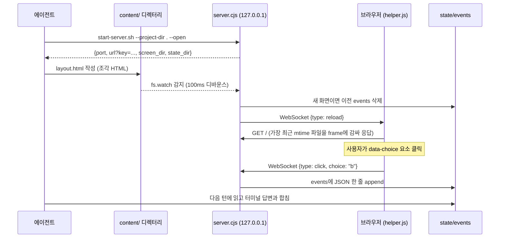

# 3. Visual Companion — 브라우저 목업 서버

대상 파일: `skills/brainstorming/visual-companion.md`, `scripts/server.cjs`(723줄), `scripts/helper.js`, `scripts/start-server.sh`, `scripts/stop-server.sh`, `scripts/frame-template.html`

터미널 대화만으로는 화면 레이아웃이나 흐름도를 고르기 어렵다. 그래서 에이전트가 HTML을 쓰면 사용자 브라우저에 띄우고,
사용자가 클릭한 선택을 에이전트가 다음 턴에 읽을 수 있게 하는 작은 로컬 서버를 둔다.

## 언제 쓰나 — 질문마다 판단

기준은 하나: **읽는 것보다 보는 게 더 잘 이해되는가?**

| 브라우저 | 터미널 |
|---------|--------|
| UI 목업, 와이어프레임 | 요구사항·범위 질문 |
| 아키텍처·데이터 흐름 다이어그램 | 말로 설명되는 A/B/C 선택 |
| 레이아웃·색상 나란히 비교 | 장단점 표 |
| 상태 머신, 흐름도 | API 설계, 데이터 모델링 |

"UI에 관한 질문"이라고 자동으로 시각 질문인 건 아니다. "어떤 마법사 화면을 원하세요?"는 개념 질문(터미널),
"이 마법사 레이아웃 중 어느 게 맞나요?"는 시각 질문(브라우저)이다.

제안 방식도 정해져 있다: 처음부터 띄우지 않고 **필요한 순간에 한 번, 단독 메시지로** 제안한다. 거절하면 다시 묻지 않는다.

## 구조

### 핵심 설계 포인트

**1. 파일 기반 인터페이스.** 에이전트는 서버 API를 호출하지 않는다. `screen_dir`에 HTML 파일을 쓰고, `state_dir/events`를 읽을 뿐이다.
→ 어떤 에이전트 하네스(Claude Code, Codex, Gemini CLI...)든 "파일 쓰기/읽기"만 되면 쓸 수 있다. 플랫폼 이식성을 위한 선택.

**2. 조각(fragment) vs 전체 문서.** `<!DOCTYPE`이나 `<html>`로 시작하지 않으면 `frame-template.html`에 감싸서 테마·연결 상태·클릭 수집 스크립트를 자동으로 붙인다.
에이전트는 내용만 쓰면 된다 → 토큰 절약과 일관된 화면.

**3. 파일명 재사용 금지, 가장 최근 파일을 서빙.** `layout.html` → `layout-v2.html`처럼 매번 새 파일을 쓴다.
새 파일이 생기면 이전 화면의 클릭 이벤트를 지워서, 지난 화면의 선택이 새 화면 답변으로 섞이지 않게 한다.

**4. 의존성 0.** WebSocket을 라이브러리 없이 RFC 6455 프레임 인코딩/디코딩으로 직접 구현했다(`computeAcceptKey`, `encodeFrame`, `decodeFrame`).
2026-03 스펙 `zero-dep-brainstorm-server-design.md`에서 결정한 것으로, 플러그인 설치 시 `npm install` 단계를 없애기 위해서다.
클라이언트 프레임 크기는 10MB로 제한한다.

## 보안 — 로컬 서버라도 열어 두지 않는다

로컬호스트 서버는 같은 PC의 **아무 브라우저 탭**이나 접근할 수 있고, `--host 0.0.0.0`으로 열면 네트워크에서도 접근된다.
그래서 다음 장치를 둔다.

| 장치 | 코드 | 막는 것 |
|------|------|--------|
| 세션 키 (`crypto.randomBytes(32)`) | `?key=` 쿼리 → 첫 접속 후 HttpOnly·SameSite=Strict 쿠키로 복사 | 다른 탭·다른 호스트의 접근, **DNS rebinding** |
| 상수 시간 비교 | `timingSafeEqualStr` | 타이밍 공격으로 키 추측 |
| WebSocket Origin 검사 | `origin === 'http://' + host` | 다른 출처 페이지가 이벤트를 주입 |
| 보안 헤더 | `X-Frame-Options: DENY`, `frame-ancestors 'none'`, `no-referrer`, `no-store` | 클릭재킹, 키가 Referer로 새는 것 |
| 콘텐츠 경로 검사 | 심볼릭 링크·하드링크(`nlink !== 1`) 거부, realpath가 content 디렉터리 안인지 확인 | 링크를 이용한 디렉터리 밖 파일 노출 |
| 키 파일 권한 | `chmod 600` | 다른 사용자가 키를 읽는 것 |
| 기본 바인드 | `127.0.0.1` | 외부 노출 |

> 주석에 이유가 적혀 있다: Host/Origin 허용 목록만으로는 DNS rebinding을 못 막지만, **URL에 실린 비밀 키**는 루프백·터널·원격 바인드 모두에서 같은 방식으로 진짜 클라이언트를 인증한다.

## 수명 관리 — 서버가 고아로 남지 않게

에이전트 대화가 끝나도 백그라운드 서버가 남으면 포트와 프로세스가 샌다. 이를 위해:

- **소유자 PID 감시:** `process.kill(ownerPid, 0)`으로 에이전트 프로세스가 살아 있는지 주기적으로 확인하고, 죽었으면 종료.
  시작 시 PID가 이미 죽어 있으면(WSL, Tailscale SSH, Windows MSYS2처럼 PID 네임스페이스가 다른 경우) 감시를 끄고 유휴 타임아웃에만 의존.
- **유휴 타임아웃:** 기본 4시간. 인증된 요청과 파일 변경만 "활동"으로 친다.
- **같은 포트·같은 키로 재시작:** `--project-dir`를 주면 포트와 토큰을 파일로 남겨, 재시작해도 열려 있던 탭이 그대로 재연결된다(끊긴 동안은 "paused" 오버레이).
- **상태 파일:** `state/server-info`(접속 정보), `state/server-stopped`(종료 표시). 에이전트는 화면을 보내기 전에 이 둘로 서버 생존을 확인해야 한다.

### 플랫폼별 백그라운드 처리 (`start-server.sh`)

| 환경 | 처리 | 이유 |
|------|------|------|
| Linux/macOS 기본 | `nohup ... &` + `disown` | 셸 종료 후에도 생존 |
| Codex (`CODEX_CI`) | 자동 foreground | Codex가 분리된 백그라운드 프로세스를 정리(reap)함 |
| Windows Git Bash (`MSYSTEM`, `MINGW*`) | 자동 foreground, 도구의 `run_in_background` 사용 | Git Bash가 nohup 프로세스를 정리함, Node가 MSYS2 PID를 못 봄 |
| Gemini / Copilot CLI | `--foreground` + 하네스의 백그라운드 실행 | 하네스가 프로세스 수명을 소유 |

## 참고: 브랜딩 이미지

프레임 상단 로고는 기본적으로 외부 URL(`primeradiant.com`)에서 이미지를 불러온다.
`SUPERPOWERS_DISABLE_TELEMETRY`, `DISABLE_TELEMETRY`, `CLAUDE_CODE_DISABLE_NONESSENTIAL_TRAFFIC` 중 하나라도 켜져 있으면 이미지 없이 텍스트만 표시한다.
즉 기본 설정에서는 목업을 열 때마다 외부 요청이 하나 나간다(referrer 없이). 사내망 등에서 신경 쓰인다면 위 환경 변수로 끌 수 있다.

## 테스트

`tests/brainstorm-server/`에 인증(auth), WebSocket 프로토콜, 수명 주기, 브라우저 실행, Windows 수명 주기, 시작·종료 스크립트 테스트가 따로 있다.
프롬프트 플러그인이지만 실행 코드가 붙은 부분은 일반 소프트웨어처럼 테스트한다.
