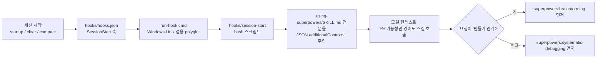

# 4. 스킬이 "알아서" 발동되는 원리

brainstorming 스킬은 사용자가 `/brainstorm`을 치지 않아도 "투두 앱 만들어 줘" 같은 말에 먼저 발동된다.
그 비밀은 스킬 본문이 아니라 **세션 시작 훅 + 메타 스킬 + 강한 description** 세 겹에 있다.


<details><summary>Mermaid 버전</summary>



</details>

## 1) SessionStart 훅

`hooks/hooks.json`은 `startup|clear|compact` 시점에 `session-start` 스크립트를 실행한다.
**compact도 포함한 이유:** 컨텍스트가 요약(compact)되면 처음 주입한 규칙이 사라질 수 있어서, 요약 직후에 다시 넣는다.

스크립트는 `using-superpowers/SKILL.md` 전체를 읽어 `<EXTREMELY_IMPORTANT>You have superpowers. ...` 로 감싸고 JSON으로 출력한다.
출력 필드는 하네스마다 다르다.

| 하네스 | 감지 | 출력 형식 |
|--------|------|-----------|
| Cursor | `CURSOR_PLUGIN_ROOT` | `additional_context` (snake_case) |
| Claude Code | `CLAUDE_PLUGIN_ROOT` | `hookSpecificOutput.additionalContext` |
| Muse | `MUSE_PLUGIN_ROOT` | Claude 형식 |
| Copilot CLI 등 | 그 외 | `additionalContext` (SDK 표준) |

> Claude Code는 두 필드를 **중복 제거 없이 둘 다** 읽기 때문에, 한 플랫폼에 맞는 필드 하나만 내보내야 한다는 주석이 있다.

### 방어적으로 짠 셸 스크립트 — 실제 장애에서 나온 코드

이 짧은 스크립트에는 이슈 번호가 붙은 우회 코드가 많다. 인프라 스크립트를 짤 때 참고할 만하다.

| 우회 | 원인 |
|------|------|
| `dirname`·`cat` 대신 `${0%[/\\]*}`, `$(<file)` | 시작 시 PATH가 깨진 채 훅이 실행되는 경우(claude-code#43127) |
| `printf ... \| cat` (cat 없으면 printf만) | Windows Git Bash에서 하네스가 stdout을 먼저 닫으면 EPIPE가 "Permission denied"로 보임(#1612) |
| heredoc 대신 `printf` | bash 5.3+ heredoc 멈춤(#571) |
| JSON 이스케이프를 `${s//old/new}`로 | 문자 단위 루프보다 훨씬 빠름 |
| `run-hook.cmd`가 현재 디렉터리의 `bash`, `where` 무시 | 레포에 `bash.cmd`를 심어 세션 시작 시 실행시키는 공격 차단(#2393) |
| WSL `bash.exe` 런처 건너뛰기 | 리눅스 배포판이 없으면 실패 |

## 2) using-superpowers — 메타 스킬

주입되는 내용의 핵심은 "**스킬이 적용될 가능성이 1%라도 있으면 반드시 호출하라**"이다.
그리고 우선순위를 정한다: 과정(process) 스킬이 먼저, 구현 스킬은 그다음.

- "X를 만들자" → brainstorming 먼저
- "이 버그 고쳐" → systematic-debugging 먼저
- plan 모드에 들어가기 전에도 brainstorming 먼저

Red Flags 표는 모델이 스킬을 건너뛰려고 할 때 떠올리는 합리화("간단한 질문이잖아", "먼저 파일만 좀 볼게")를 미리 적어 두고 반박한다.
**LLM의 합리화 패턴을 표로 선제 차단**하는 기법이다.

단, 맨 위에 `<SUBAGENT-STOP>`이 있다. 서브에이전트로 특정 작업을 받은 경우엔 이 규칙을 무시한다 → Builder check 서브에이전트가 다시 brainstorming을 돌리는 무한 루프를 막는다.

또한 **사용자 지시(CLAUDE.md 등)가 스킬보다 우선**한다고 명시한다. 스킬은 기본 동작을 덮어쓰지만 사용자를 덮어쓰지는 않는다.

## 3) description 문구

```
You MUST use this before any creative work - creating features, building components,
adding functionality, modifying behavior, or planning anything new, in software or out of it
```

Claude Code는 스킬 목록을 description으로만 보여 주므로, 이 한 줄이 발동 여부를 결정한다. 2025-12에 두 번(`3f725ff`, `612fbcd`) 트리거를 강화한 이력이 있다.
대신 "너무 자주 발동"되는 비용은 스킬 본문의 첫 점검("요청에 다 있으면 바로 해라")으로 낮춘다. **트리거는 넓게, 진입 비용은 싸게** 하는 조합이다.

## 훅이 없는 플랫폼

Antigravity는 세션 시작 훅이 없다. 대신 using-superpowers의 description("Use when starting any conversation")만으로 모델이 스스로 로드하게 하고,
v7.0.0 릴리스 노트에 따르면 12회 실행에서 "react 투두 리스트 만들자"가 코드보다 brainstorming을 먼저 발동시켰다.
