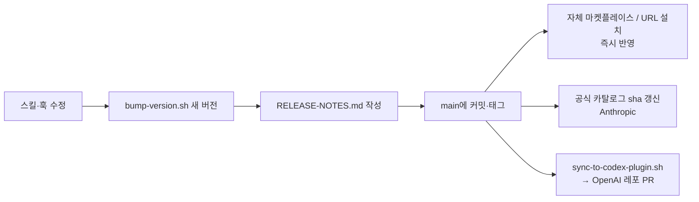

# superpowers는 어떻게 "스토어"에 올라가나


분석 기준: `obra/superpowers` v7.0.0 (`bb92a77`), 로컬에 설치된 Anthropic 공식 마켓플레이스(`anthropics/claude-plugins-official`) 카탈로그

## 한 줄 요약

> **레포 하나, 매니페스트 여러 개.** 실제 내용(`skills/`, `hooks/`)은 한 벌만 두고,
> 에이전트 플랫폼(하네스)마다 얇은 매니페스트 파일로 감싸서 **공식 마켓플레이스 / 자체 마켓플레이스 / 레포 URL 직접 설치** 세 경로로 배포한다.

## 1. 하네스별 매니페스트

레포 루트에 하네스마다 숨김 폴더가 있다. 내용은 대부분 이름·버전·설명이고, 스킬과 훅의 위치만 하네스 형식에 맞춰 알려 준다.

| 하네스 | 파일 | 특징 |
|--------|------|------|
| Claude Code | `.claude-plugin/plugin.json` | 이름·버전·작성자·라이선스·키워드. `skills/`, `hooks/hooks.json`은 기본 위치라 따로 적지 않음 |
| Claude Code | `.claude-plugin/marketplace.json` | **이 레포 자체를 마켓플레이스로** 쓰게 해 주는 카탈로그(`superpowers-dev`, `source: "./"`) |
| Codex | `.codex-plugin/plugin.json` | `skills` 경로 + 스토어 화면용 `interface`(표시 이름, 카테고리, 아이콘, 브랜드 색, 추천 프롬프트, 개인정보·약관 URL) |
| Cursor | `.cursor-plugin/plugin.json` | `skills` 경로 + Cursor 전용 훅 파일 `hooks/hooks-cursor.json` |
| Antigravity | `.antigravity-plugin/plugin.json` | 로고, 추천 프롬프트. 훅이 없어서 스킬 description으로 부트스트랩 |
| Gemini CLI | `gemini-extension.json` | `contextFileName: GEMINI.md` — 확장의 컨텍스트 파일 지정 |
| 그 외 | `.devin-plugin/`, `.kimi-plugin/`, `.muse-plugin/`, `.hermes-plugin/`, `.opencode/`, `.pi/` | 같은 방식 |

**설계 이유:** 스킬 본문을 하네스별로 복사하면 금방 서로 달라진다. 매니페스트만 나누면 스킬은 한 곳에서 고치고, 하네스 차이는 매니페스트와 훅 출력 형식(→ [04-bootstrap](../brainstorming/04-bootstrap.md))에서만 처리하면 된다.

## 2. 세 가지 배포 경로

### ① 공식 마켓플레이스 — 심사를 거쳐 기본 목록에 노출

| 스토어 | 등록 방식 | 사용자 설치 |
|--------|-----------|-------------|
| Anthropic `claude-plugins-official` | 제출 양식으로 신청 → 품질·보안 심사 → 카탈로그에 항목 추가 | `/plugin install superpowers@claude-plugins-official` 또는 `/plugin > Discover` |
| OpenAI Codex `openai/plugins` | `scripts/sync-to-codex-plugin.sh`가 포크 레포에 플러그인을 동기화하고 **PR을 연다** | Codex 앱 Plugins 탭, CLI `/plugins` |
| xAI Grok `xai-org/plugin-marketplace` | 공식 마켓플레이스 레포에 등록 | `grok plugin install superpowers@xai-official` |
| Cursor | Cursor 마켓플레이스 | `/add-plugin superpowers` |

Anthropic 공식 카탈로그에 실제로 들어 있는 superpowers 항목은 이렇다(315개 플러그인 중 하나).

```json
{
  "name": "superpowers",
  "description": "Superpowers teaches Claude brainstorming, subagent driven development ...",
  "category": "development",
  "source": {
    "source": "url",
    "url": "https://github.com/obra/superpowers.git",
    "sha": "bb92a77741419a4ab5f06e711a283343f1ada0c3"
  },
  "homepage": "https://github.com/obra/superpowers.git"
}
```

핵심은 **`sha`로 커밋을 고정**한다는 점이다. 플러그인 레포에 새 커밋이 올라가도 공식 스토어 사용자는 바로 받지 않는다. 카탈로그의 sha가 갱신돼야 새 버전이 나간다.
→ 심사받은 코드와 실제 배포되는 코드를 일치시키기 위한 장치다. 플러그인은 훅으로 셸 명령을 실행할 수 있어서, 심사 후 몰래 바뀌는 것(공급망 공격)을 막아야 한다.

공식 카탈로그 README가 정한 규칙도 있다.
- **이름(`name`)은 바꿀 수 없다.** 사용자는 그 슬러그로 설치했기 때문에, 바꾸면 `plugin-not-found`가 난다. 화면 표시명은 `displayName`으로 바꾸고, 꼭 바꿔야 하면 `renames` 맵으로 자동 이전시킨다.
- 매니페스트 없이 `SKILL.md`만 있는 레포도 `strict: false` + `skills` 배열로 "스킬 묶음 플러그인"으로 등록할 수 있다.

### ② 자체 마켓플레이스 — GitHub 레포가 곧 스토어

심사 없이 누구나 만들 수 있다. `marketplace.json`이 있는 GitHub 레포를 사용자가 등록하면 된다.

```bash
/plugin marketplace add obra/superpowers-marketplace
/plugin install superpowers@superpowers-marketplace
```

superpowers는 두 개를 운영한다.
- `obra/superpowers-marketplace`: superpowers와 관련 플러그인을 모은 별도 카탈로그 레포 (Claude Code, Copilot CLI가 같은 형식을 씀)
- `obra/superpowers` 자체의 `.claude-plugin/marketplace.json`(`superpowers-dev`): 개발용. `source: "./"`로 레포 자신을 가리킨다

**왜 공식이 있는데 자체도 두나:** 공식 스토어는 sha 갱신과 심사를 기다려야 한다. 자체 마켓플레이스는 저자가 바로 새 버전을 내보내거나 실험용 플러그인을 함께 배포할 수 있다.

### ③ 레포 URL 직접 설치 — 마켓플레이스 없이

```bash
gemini extensions install https://github.com/obra/superpowers
agy plugin install https://github.com/obra/superpowers
devin plugins install obra/superpowers
```

하네스가 레포를 클론하고 루트의 자기 매니페스트(`gemini-extension.json`, `.antigravity-plugin/`, `.devin-plugin/`)를 읽는다. 그래서 매니페스트가 **레포 루트**에 있어야 한다.

## 3. 버전 관리 — 12개 파일을 한 번에

매니페스트가 많아지면 버전 번호가 서로 어긋나기 쉽다. `.version-bump.json`에 버전이 적힌 파일 12곳을 등록해 두고, `scripts/bump-version.sh`로 한꺼번에 관리한다.

```bash
scripts/bump-version.sh 7.1.0     # 등록된 12개 파일의 버전을 한 번에 변경
scripts/bump-version.sh --check   # 파일 간 버전 불일치(drift) 보고
scripts/bump-version.sh --audit   # + 레포 전체에서 옛 버전 문자열 검색
```

등록 파일: `package.json`, 각 하네스 `plugin.json`, `.claude-plugin/marketplace.json`의 `plugins.0.version`, `gemini-extension.json` 등.

릴리스 흐름:



## 4. 내 플러그인을 올리려면 (Claude Code 기준)

예: ai-judge-platform의 `/review` 스킬을 플러그인으로 배포하는 경우.

**1) 구조 만들기**

```
my-plugin/
├── .claude-plugin/
│   ├── plugin.json        # 필수: name, description, version, author, license
│   └── marketplace.json   # 자체 마켓플레이스로 쓸 때
├── skills/
│   └── review/SKILL.md    # 프론트매터의 description이 발동 조건
├── commands/              # 선택: 슬래시 명령
├── agents/                # 선택: 서브에이전트 정의
├── hooks/hooks.json       # 선택: SessionStart 등
└── README.md
```

**2) 자체 마켓플레이스로 배포** — 심사 없이 바로

`marketplace.json`에 플러그인을 적고 GitHub에 push한다.

```json
{
  "name": "yeomyaloo-plugins",
  "owner": { "name": "yeomyaloo" },
  "plugins": [
    { "name": "ai-judge-review", "source": "./", "description": "알고리즘 풀이 채점·리뷰", "version": "0.1.0" }
  ]
}
```

사용자는 이렇게 설치한다.

```bash
/plugin marketplace add yeomyaloo/<레포 이름>
/plugin install ai-judge-review@yeomyaloo-plugins
```

**3) 공식 마켓플레이스에 신청** — `/plugin > Discover`에 노출

공식 카탈로그 README의 [플러그인 디렉터리 제출 양식](https://clau.de/plugin-directory-submission)으로 신청한다. 품질·보안 기준을 통과해야 `external_plugins`에 들어간다.
신청 전에 준비할 것:
- 공개 레포, 라이선스, README(무엇을 하는지, 훅·MCP가 무엇을 실행하는지)
- 바꾸지 않을 `name` 확정
- 훅이 있다면 비밀값 출력·외부 전송이 없는지 점검 (superpowers도 v7.0.0에서 현재 폴더의 `bash.cmd`를 실행하지 않도록 고쳤다)

## 배울 점

1. **콘텐츠와 패키징 분리.** 스킬은 하나, 매니페스트는 하네스별. 새 하네스 지원은 매니페스트 하나 추가로 끝난다.
2. **신뢰는 sha 고정으로.** 공식 스토어는 "이 커밋을 심사했다"를 카탈로그에 박아 둔다. 쿠버네티스 이미지를 태그 대신 digest로 고정하는 것과 같은 원리다.
3. **이름은 API다.** 한번 배포한 슬러그는 바꾸지 않는다. 표시명과 식별자를 분리한다.
4. **버전 드리프트는 도구로 막는다.** 사람이 12개 파일을 손으로 맞추지 않는다. `--check`/`--audit`로 검증한다.
5. **공식 + 자체 이중 채널.** 공식은 노출과 신뢰, 자체는 속도와 실험.
